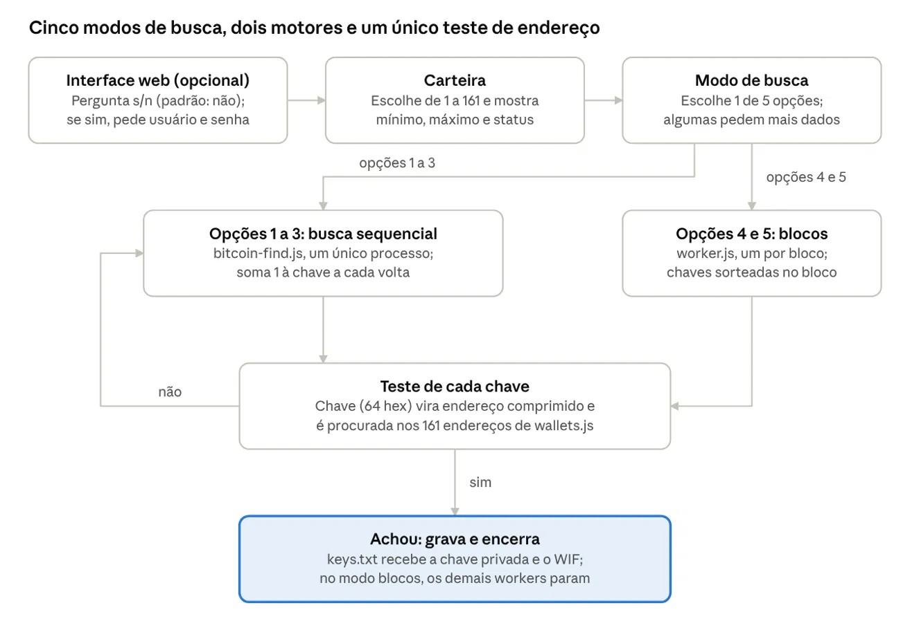

# Bitcoin-Puzzle-Lab

## Visão geral

O Bitcoin-Puzzle-Lab é um programa de terminal em Node.js que testa chaves privadas de Bitcoin, uma a uma, até gerar um dos 161 endereços cadastrados no projeto.

O código chama esses endereços de "carteiras puzzle": cada uma tem a chave privada dentro de uma faixa conhecida de números, e o programa tenta achá-la por força bruta na faixa que a pessoa escolher.

O fluxo é sempre o mesmo:

1. A pessoa escolhe uma carteira (1 a 161) e um modo de busca no terminal.
2. O programa gera chaves dentro da faixa, converte cada uma em endereço Bitcoin e compara com a lista cadastrada.
3. Se houver correspondência, grava a chave privada em `keys.txt` e encerra a busca.

Há também uma interface web opcional (beta) que mostra o saldo e a lista das chaves encontradas.

O escopo é fechado: o programa só confere os 161 endereços de `src/data/wallets.js`. Ele não varre carteiras de terceiros, e a única chamada de rede é a consulta de saldo das chaves já encontradas, feita pela interface web.

## Estrutura do projeto

A lógica de busca fica em `src/`, os dados das carteiras em `src/data/` e a interface beta em `web-interface/`.

| Arquivo | Papel |
| --- | --- |
| `src/main.js` | Ponto de entrada: mostra o banner, pergunta pela interface web, abre o menu e dispara a busca |
| `src/bitcoin-find.js` | Busca sequencial em uma única thread, a partir de uma chave inicial |
| `src/worker.js` | Busca aleatória dentro de um bloco, executada como worker thread |
| `src/data/wallets.js` | Lista dos 161 endereços procurados |
| `src/data/ranges.js` | Faixa mínima e máxima de cada carteira, com status (1 encontrada, 0 não encontrada) |
| `src/utils/` | Perguntas do menu (`escolherCarteira`, `escolherMinimo`, `escolherPorcentagem`, `escolherPorcentagemBlocos`, `fazerPergunta`, `readInterface`) e geração de endereço e WIF (`generators.js`) |
| `web-interface/app.js` | Servidor Express com socket.io da interface beta |
| `web-interface/views/` | `index.ejs` (saldo e contagem) e `keys.ejs` (lista de chaves WIF) |
| `Dockerfile` | Imagem `node:14` que clona o repositório do GitHub e roda `npm start` |
| `README.md` | Instruções para rodar na máquina e em container |

### Tecnologias

O projeto usa ES Modules (`"type": "module"` no `package.json`). As dependências realmente usadas no código são:

- `coinkey`: transforma a chave privada em endereço e em WIF.
- `chalk`: cores no terminal.
- `express`, `socket.io`, `ejs`, `express-basic-auth` e `axios`: interface web e consulta de saldo.

Os pacotes `node-fetch`, `nodemon`, `postcss` e `tailwindcss` estão no `package.json`, mas nenhum arquivo JavaScript os importa.

### Como executar

1. Na máquina: `npm install` e depois `npm start`, que roda `node src/main.js`. Execute sempre a partir da raiz do projeto.
2. Em container: `docker buildx build --no-cache -t bitcoin-puzzle-lab .` e depois `docker run -it --name bitcoin-puzzle-lab -p 3000:3000 bitcoin-puzzle-lab`.

## Fluxo de execução

Todos os caminhos acabam no mesmo teste de endereço; o que muda é como as chaves são escolhidas e quantos processos as testam.

As opções 1 a 3 e as opções 4 e 5 usam motores diferentes, mas voltam ao mesmo teste; sem correspondência, cada motor testa a próxima chave, e só um acerto interrompe a busca.

## Regras de negócio

As regras abaixo descrevem o que o código faz hoje, inclusive comportamentos que provavelmente não eram a intenção (veja a última seção).

### Carteiras e faixas

- **RN-01** Existem 161 carteiras, numeradas de 1 a 161. Qualquer outro valor é recusado e a pergunta se repete.
- **RN-02** Nas carteiras 1 a 160, a faixa da carteira N vai de 2^(N−1) até 2^N − 1. Exemplos: a carteira 2 cobre 0x2 a 0x3, e a carteira 66 cobre 0x20000000000000000 a 0x3ffffffffffffffff.
- **RN-03** A carteira 161 não segue essa regra. Sua faixa vai de `0xC0DE…327ef00cb3000000` a `0xC0DE…327ef00cb3ffffff` (16.777.216 chaves); os valores completos estão em `src/data/ranges.js`.
- **RN-04** Cada faixa tem um status: 1 = já encontrada (78 faixas, contando a 161) e 0 = ainda não encontrada (83 faixas). O programa mostra "Encontrada" em vermelho ou "Nao Encontrada" em verde, mas não impede a busca em faixas já resolvidas.
- **RN-05** Ao escolher a carteira, o programa mostra o mínimo, o máximo e o "número possível de chaves" (máximo − mínimo).

### Geração e comparação de chaves

- **RN-06** Cada chave candidata é um inteiro, escrito em hexadecimal e completado com zeros à esquerda até 64 caracteres.
- **RN-07** O endereço é derivado da chave pública comprimida (formato Bitcoin que começa com "1"), pela biblioteca `coinkey`.
- **RN-08** A comparação é feita contra os 161 endereços de `wallets.js`, não apenas contra o da carteira escolhida. Qualquer correspondência conta como achado.
- **RN-09** Ao achar, o programa imprime a chave privada e o WIF, acrescenta uma linha `Private key: <hex>, WIF: <wif>` em `keys.txt` e encerra a busca. Nos blocos, a linha ganha o prefixo `Worker para Bloco N:`.

### Modos de busca

| Opção | Nome no menu | Comportamento real |
| --- | --- | --- |
| 1 | Comecar do inicio | Busca sequencial a partir do mínimo da faixa, em um único processo |
| 2 | Escolher uma porcentagem | A pessoa digita um número de 0 a 1; a busca sequencial começa em mínimo + (máximo − mínimo) × número |
| 3 | Escolher minimo | A pessoa digita o início em hexadecimal (com ou sem `0x`); busca sequencial a partir dele |
| 4 | Dividir em blocos | Divide a faixa em N blocos e abre um worker por bloco; cada worker sorteia chaves dentro do seu bloco |
| 5 | Dividir em blocos (Randomico) | Igual à opção 4: o indicador `random` é enviado ao worker, mas ele o ignora |

- **RN-10** Nas opções 4 e 5, o programa pergunta o número de blocos; se a resposta ficar vazia ou for 0, usa o número de CPUs da máquina.
- **RN-11** O tamanho do bloco é (máximo − mínimo) ÷ N, em divisão inteira. O bloco i começa em mínimo + tamanho × i, e o último termina no máximo da faixa. Os blocos são impressos (início, fim e intervalo) antes de a busca começar.
- **RN-12** Na busca por blocos, cada tentativa sorteia um deslocamento dentro do bloco e pula chaves testadas há pouco. A memória de chaves testadas guarda até 1.000.000 entradas; ao passar disso, descarta a metade mais antiga.
- **RN-13** Quando um worker acha uma chave, o processo principal encerra todos os outros.

### Acompanhamento

- **RN-14** A cada segundo o programa imprime o tempo decorrido (e o progresso, nos workers). A cada 10 segundos limpa o terminal, mostra velocidade, total de chaves testadas e última chave, e grava `Ultima_chave.txt` (sequencial) ou `Ultima_chave_bloco_N.txt` (por bloco). Esses arquivos só são gravados: nada os lê para retomar a busca.

### Interface web (beta)

- **RN-15** Ao iniciar, o programa pergunta se deseja abrir a interface web (padrão: não). Se a resposta for sim, pede usuário e senha, que protegem apenas a página `/keys`.
- **RN-16** A página inicial mostra o saldo total em BTC e a quantidade de carteiras encontradas. O saldo soma o `final_balance` dos endereços das chaves de `keys.txt`, consultado na API do blockchain.info e arredondado a 2 casas. Ele atualiza em tempo real via socket.io quando `keys.txt` muda, fica em cache por 60 segundos e também é gravado em `saldo.txt`.
- **RN-17** A página `/keys` lista as chaves WIF encontradas, cada uma com um botão "Copiar". O servidor usa a porta 3000.